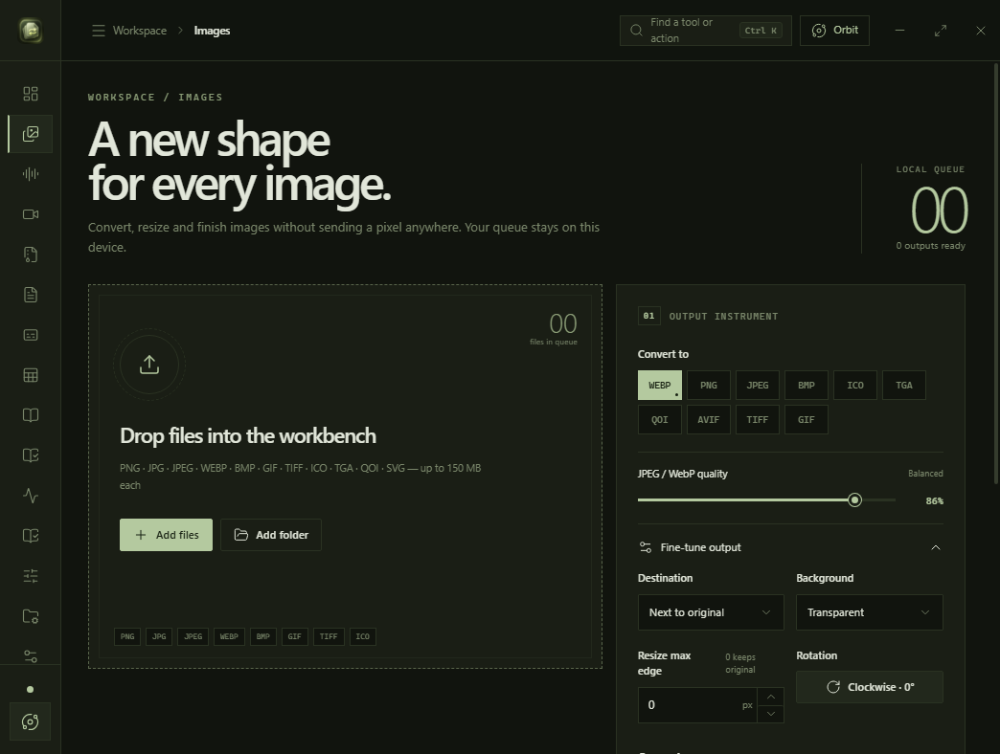
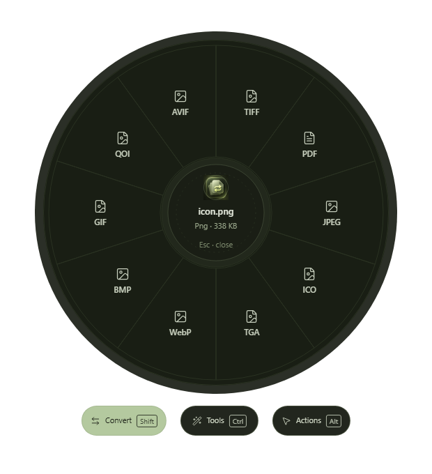
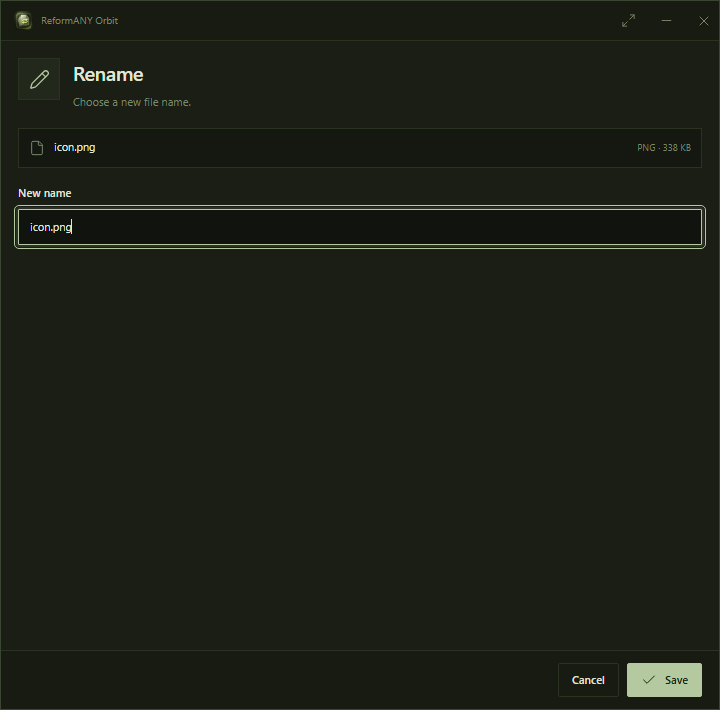

<p align="center">
  
</p>

<h1 align="center">ReformANY</h1>

<p align="center"><strong>File work, simplified.</strong></p>
<p align="center">
  A local-first Windows workspace for conversion, preview, and everyday file utilities.
</p>
<p align="center">
  <a href="docs/PRODUCT_GALLERY.md">Explore the interface</a> ·
  <a href="docs/FORMAT_SUPPORT.md">Supported formats</a> ·
  <a href="docs/DEVELOPMENT.md">Development &amp; testing</a>
</p>

---

### The workspace



A single desktop environment for working with images, media, documents, PDFs, archives, and other supported file types. ReformANY favors direct controls, readable detail, and an interface that stays out of the way.

### Orbit — work from the file itself

<p align="center">
  
</p>

Orbit brings contextual file actions to a circular desktop menu. The original wheel remains intact; a distinct bottom control bar provides **Convert**, **Tools**, and **Actions**. Keyboard mappings and desktop integration are part of the active Windows development work.

### Tools that feel native

<p align="center">
  
</p>

Dedicated tool windows keep focused tasks separate from the main workspace. The dark-green palette, restrained linework, and deliberate spacing carry through from the app to Orbit.

## Built for the desktop

| Principle | Approach |
| :-- | :-- |
| **Local by design** | Core file processing runs on the user's computer; no login or cloud workspace is required. |
| **Originals respected** | Conversion and PDF tools are intended to write new outputs rather than silently replace source files. |
| **Fast access** | Main workspace for longer jobs; Orbit for contextual actions in Windows Explorer. |
| **Clear scope** | Format support depends on the operation and the available local conversion engines. |
| **Considered design** | A consistent green identity, strong hierarchy, and limited visual effects. |

See the [media workspace](docs/PRODUCT_GALLERY.md#media-workspace) and the [format support matrix](docs/FORMAT_SUPPORT.md).

## Development status

**In active development. Not a public release.**

The screenshots here are **real Windows UI captures** from the current ReformANY recovery work ([draft PR #19](https://github.com/p4yy/ReformANY/pull/19), commit `be3f2195`), not renders or concepts. They document the latest visual direction; this design branch is not a claim that every pictured change has already been merged into it.

Windows CI exercises the application, Orbit, HoveR preview, and setup flows. Physical Windows desktop acceptance—including Shake, panel movement, tray behavior, audio control, and remaining regression checks—still requires direct testing and approval. **Do not publish a GitHub Release without explicit owner sign-off.**

## Build locally

Requires **Node.js 22+**, a stable Rust toolchain, and the [Tauri 2 Windows prerequisites](https://v2.tauri.app/start/prerequisites/).

```bash
npm install
npm run tauri dev
```

To package a Windows build:

```bash
npm run tauri build
```

For architecture, privacy, and dependency details, see [Architecture](docs/ARCHITECTURE.md), [Privacy](docs/PRIVACY.md), and [Provenance](docs/PROVENANCE.md).

---

<sub>Designed and developed by **Acev Dev Co.** · © 2026 Acev Dev Co. All rights reserved. Source-available, not open source. [License](LICENSE) · [Reuse terms](docs/REUSE_AND_ATTRIBUTION.md)</sub>
