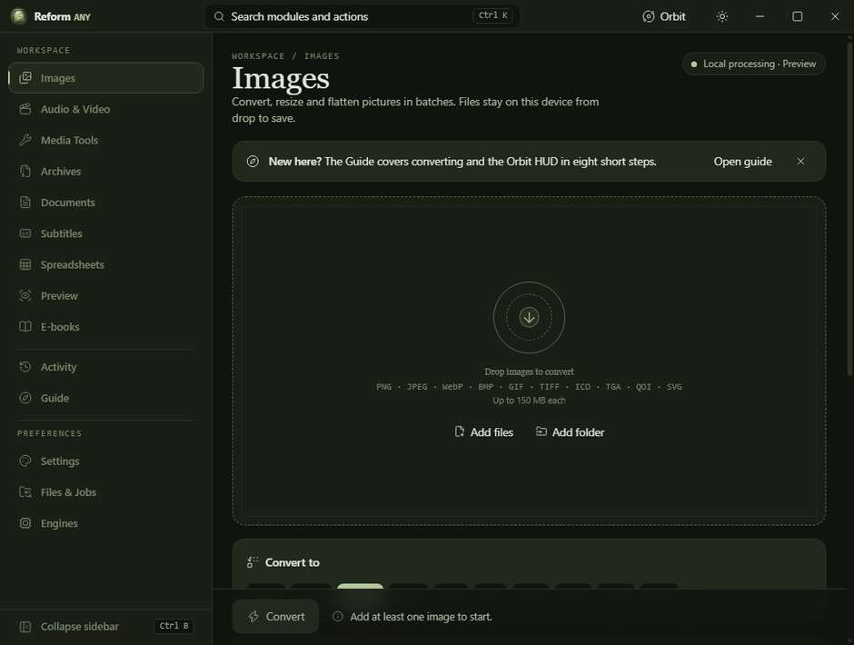
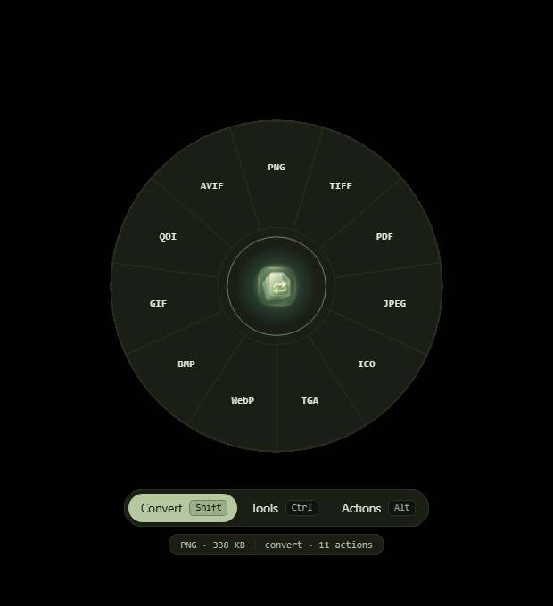
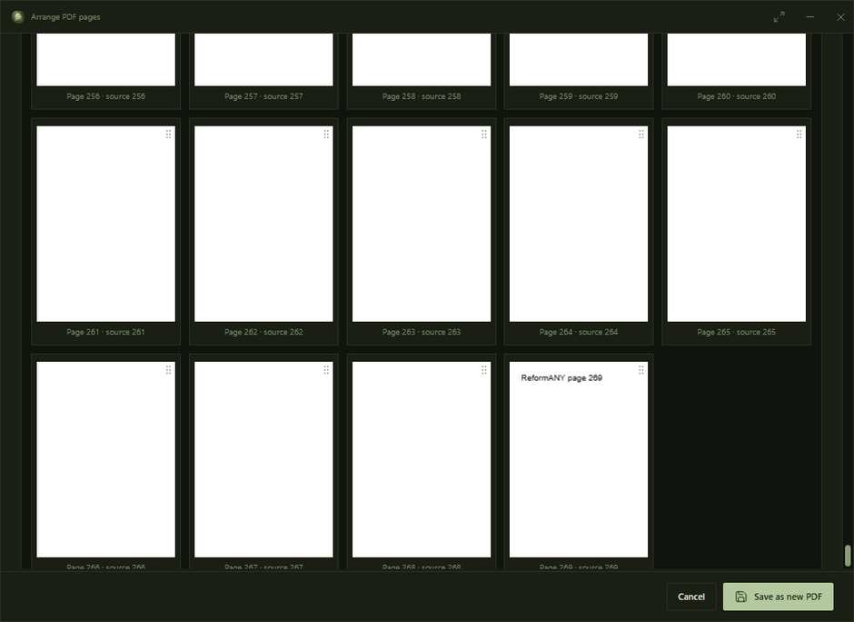
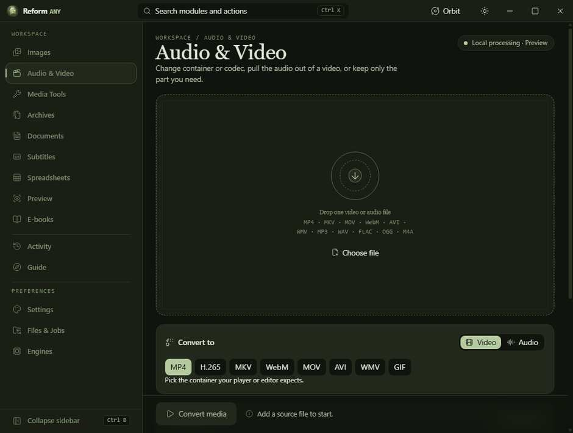

<p align="center">
  
</p>

<h1 align="center">ReformANY</h1>

<p align="center">
  <strong>File conversion and document tools, built for your Windows desktop.</strong><br>
  Convert locally. Work from File Explorer. Keep the originals.
</p>

<p align="center">
  <a href="https://github.com/p4yy/ReformANY/actions/workflows/checks.yml"></a>
  <a href="https://github.com/p4yy/ReformANY/actions/workflows/windows-release.yml"></a>
  <a href="LICENSE"></a>
  <a href="https://github.com/p4yy/ReformANY/stargazers"></a>
</p>

ReformANY is a Windows application for converting supported images, PDFs, documents, audio, video, archives and structured data. It combines a full desktop workspace with **ReformANY Orbit**, a circular File Explorer shortcut for quick file actions. Conversion runs on your PC, without a ReformANY account or a remote conversion service.

**Project status:** Actively developed. The latest Windows builds are **private test builds**, not an approved or published v1.0.0 release. Format coverage and conversion quality vary by source file and installed engine. See the [format support matrix](docs/FORMAT_SUPPORT.md) and [release checklist](docs/RELEASE_CHECKLIST.md).

## The application

These are **actual captures from the Windows CI test build**, using synthetic test data. They are not personal desktop screenshots, chat reference images or product mockups.

<p align="center">
  <a href="docs/product/images-workspace.jpg"></a>
</p>
<p align="center"><sub>Images workspace · local processing · the dark sage-green interface</sub></p>

<table>
  <tr>
    <td align="center" width="45%">
      <a href="docs/product/orbit-wheel.jpg"></a><br>
      <sub>Orbit · circular file-action menu</sub>
    </td>
    <td align="center" width="55%">
      <a href="docs/product/pdf-arrange-269.jpg"></a><br>
      <sub>PDF pages · scroll through large documents</sub>
    </td>
  </tr>
</table>

<p align="center">
  <a href="docs/product/audio-video.jpg"></a>
</p>
<p align="center"><sub>Audio and video · format-specific conversion controls</sub></p>

## What ReformANY does

| Workspace or feature | Included capabilities |
| --- | --- |
| **Orbit** | Right-click a file or folder in File Explorer to open a compact circular menu with Convert, Tools and Actions. Windows 11 may show this under **Show more options**. |
| **Shake to Orbit** | Optional hold-and-shake gesture for files or folders in Windows Explorer; enabled and tuned through Orbit settings. The native detector exists in the development build, but real-device behavior still needs wider Windows QA. |
| **HoveR** | Quick local file preview and actions from Orbit, where supported. |
| **Images** | Batch conversion, resizing, rotation, grayscale, quality selection and transparency handling for supported raster formats. |
| **PDF** | View pages, arrange and extract pages, export page images, add watermarks, apply visible signatures and create password-protected copies. Visible signatures are **not** cryptographic digital signatures. |
| **Documents and data** | Text-based PDF extraction, selected Office and e-book conversion routes, spreadsheet/table conversion and subtitle conversion. Some operations need external engines. |
| **Audio and video** | FFmpeg-based transcode, compression, trim and selected media tools, with available codecs depending on the engine. |
| **Archives and file tools** | ZIP creation/extraction (including encrypted ZIP), format-dependent external archive tools, file splitting and joining with integrity checks. |

The application creates separate outputs for supported operations; keep your source files until you verify the results in another viewer.

## Supported formats

These are **format families and available routes**, not a promise that every input can be converted to every output.

| Category | Common supported formats | Important detail |
| --- | --- | --- |
| Raster images | PNG, JPG/JPEG, WebP, BMP, static GIF, single-page TIFF, TGA, QOI, ICO | Animation, multipage variants and some metadata are not preserved or supported. |
| Vector images | SVG → supported raster outputs | Only self-contained SVG; input limits and active-content checks apply. |
| PDF | PDF, JPG/PNG page images, TXT, Markdown, HTML | Image rendering, page tools and text extraction are different operations. Scanned-PDF text needs OCR, which is not built in. |
| Audio | MP3, M4A, WAV, FLAC, OGG, Opus | Requires a compatible local FFmpeg/FFprobe engine and codecs. |
| Video | MP4, WebM, MKV, MOV, AVI | Available video/audio profiles determine actual output compatibility. |
| Archives | ZIP, 7z, RAR, TAR, GZip, BZip2, XZ, WIM | ZIP is built in; other routes require compatible local 7-Zip or WinRAR tools. |
| Spreadsheets and tables | CSV, TSV, JSON, XLSX; XLS/ODS import | Values-only conversion; advanced formulas, styling and multi-sheet fidelity are not guaranteed. |
| Subtitles | SRT ↔ WebVTT | Selected timing and text features only. |
| Office documents and e-books | Selected DOC/DOCX/PPT/PPTX and EPUB/MOBI/FB2/AZW3 routes | LibreOffice or Calibre may be required. DRM is not bypassed. |

For exact read/write directions, source-size limits and unsupported combinations, read **[Supported formats and limitations](docs/FORMAT_SUPPORT.md)**. Not general-purpose: HEIC/HEIF, PSD, RAW camera files, animated-image preservation, PDF OCR or arbitrary DRM removal.

## Download and installation

An official stable v1.0.0 release is **not yet published**. For development testing, use the [Windows build workflow](https://github.com/p4yy/ReformANY/actions/workflows/windows-release.yml) and select an artifact built from the commit you intend to test. GitHub Actions artifacts are temporary and may require sign-in.

**Portable — `ReformANY.exe`**

1. Download the separately named **Portable-EXE-test** ZIP from a successful Windows build.
2. Extract the ZIP and run `ReformANY.exe`. The portable executable does **not** require the setup wizard.
3. If you enable optional Explorer integration, local settings or per-user registry entries may be created. Portable does not mean zero persistence.

**Installer — `reformany-setup.exe`**

Download the separately named **Premium-Setup-EXE-test** ZIP, extract it, and run `reformany-setup.exe`. It provides an offline setup UI. **Do not confuse the installer with the portable app.**

**Requirements:** Windows 10/11 (64-bit), WebView2, sufficient storage for originals and output files. Some optional conversions depend on installed LibreOffice, Calibre, 7-Zip or WinRAR. Verified Windows test packages include offline FFmpeg/FFprobe; source builds can use a locally installed engine. Unsigned test executables may trigger SmartScreen; verify the source before running them.

## Using Orbit

1. Select a supported file or folder in File Explorer.
2. Right-click and choose **ReformANY Orbit** (possibly under **Show more options** on Windows 11).
3. Choose **Convert**, **Tools** or **Actions**, then select an available operation.
4. Use the dedicated tool window for settings or PDF pages; scroll the **outer-right scrollbar** to reach long forms and page collections.
5. Check the created output before deleting or moving the original.

**Shake to Orbit** is an optional Windows drag gesture; its availability depends on the native listener, Windows Explorer behavior and your Orbit settings. It is under ongoing hands-on compatibility testing. [Orbit details](docs/ORBIT.md).

## Build from source

This public repository is **source-available, not open source**. Review [LICENSE](LICENSE) before copying, modifying, building or redistributing the first-party code.

Prerequisites: Node.js 22+, current stable Rust, the [Tauri 2 Windows prerequisites](https://v2.tauri.app/start/prerequisites/) and Windows build tools.

```powershell
npm install
npm run typecheck
npm run privacy:check
cargo test --manifest-path src-tauri/Cargo.toml
npm run tauri dev
```

The Windows CI workflow builds the native executable, premium setup and standalone portable test artifact through additional packaging steps. For project-specific commands and checks, see [Development](docs/DEVELOPMENT.md).

## Privacy, security and release status

- Core conversion and preview operations run locally. ReformANY does not require a cloud account or upload documents to a ReformANY server.
- Some optional format routes invoke software installed on the device. See the [privacy contract](docs/PRIVACY.md) for settings, local storage and engine details.
- **Security work remains open.** High/critical dependency advisories and clean-Windows acceptance requirements must be resolved before any stable release. Passing CI or displaying a screenshot is not certification.
- Report suspected vulnerabilities privately through [SECURITY.md](SECURITY.md), not a public issue.

## Project information

[Roadmap](docs/ROADMAP.md) · [Changelog](CHANGELOG.md) · [Contributing](CONTRIBUTING.md) · [Code of conduct](CODE_OF_CONDUCT.md) · [Release readiness](docs/RELEASE_CHECKLIST.md)

## Support development

ReformANY is independently developed. Donations are optional and do not grant redistribution rights or preferential support.

<p align="center">
  <a href="https://www.paypal.com/paypalme/aceevisuals"></a>
  &nbsp;
  <a href="https://ko-fi.com/acevisualsco"></a>
</p>

## License

Copyright © 2026 **Acev Dev Co**. All rights reserved. ReformANY is publicly viewable under a **proprietary, source-available license**; it is not released under MIT or GPL. Any permissions to evaluate, modify or redistribute the software are governed by [LICENSE](LICENSE). Third-party components retain their own licenses.
