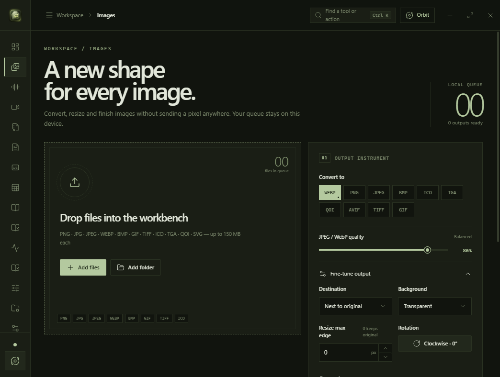
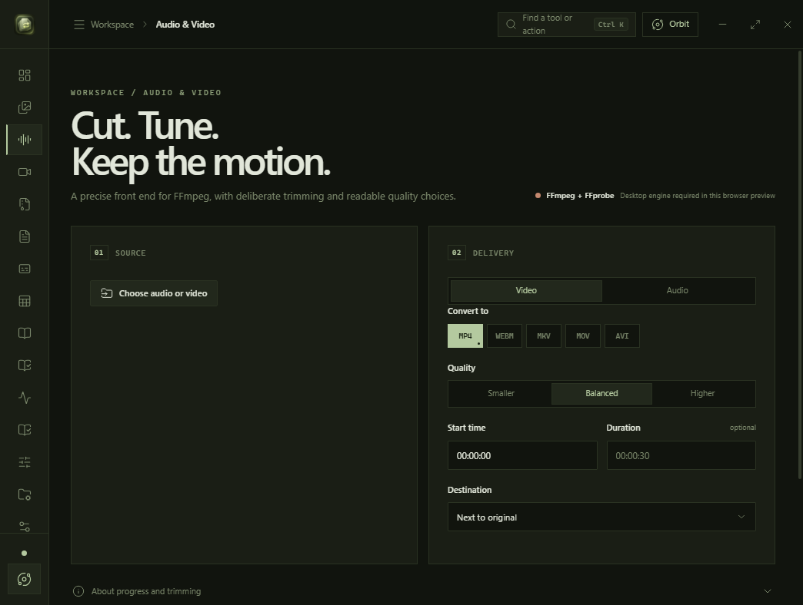
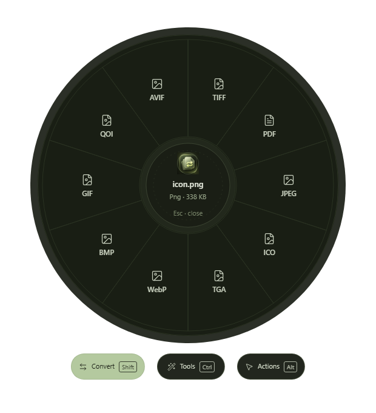
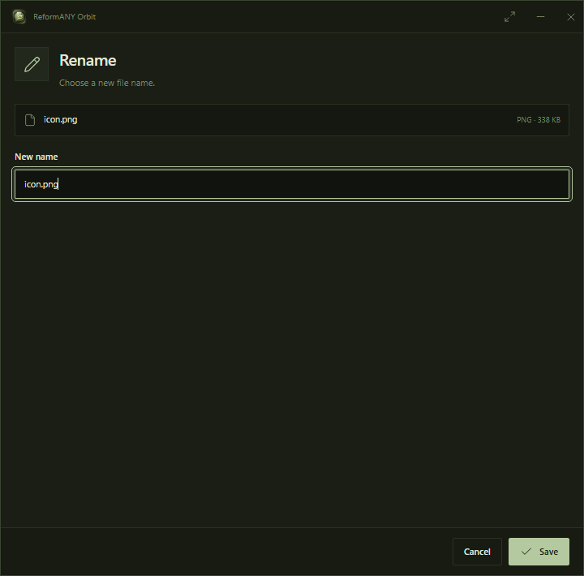

# ReformANY — product gallery

Real captures of the Windows application, recorded by the project's Windows UI smoke-test suite. These are **screenshots of the working interface**, not marketing mockups or image-generated concepts.

**Capture source:** [ReformANY recovery PR #19](https://github.com/p4yy/ReformANY/pull/19) · Windows build for commit `be3f2195` · November 10, 2026.

The screenshots illustrate the current visual direction. The project is still under development, and real-device acceptance testing remains required before a public release.

---

## Main workspace

A focused environment with consistent navigation, a dark-green palette, and clear primary actions.

## Media workspace

Audio and video workflows presented within the same desktop shell.

## Orbit

  

The original circular Orbit menu, captured on its own, with the separate **Convert · Tools · Actions** controls beneath it.

## Independent Orbit tool window

  

The Rename tool's individual frameless window, using the same green system as the main app and Orbit.

---

## Presentation notes

- Product screenshots are kept unmodified for fidelity to the Windows capture.
- The official green ReformANY logo is the existing `public/brand/reformany-icon.png` asset.
- Screenshots are documentation assets only. They do not change the Orbit circle, gestures, or any application runtime logic.
- This branch update is **not** a release, installer publication, or completion sign-off.

[Back to ReformANY](../README.md) · [Current development PR](https://github.com/p4yy/ReformANY/pull/19)
